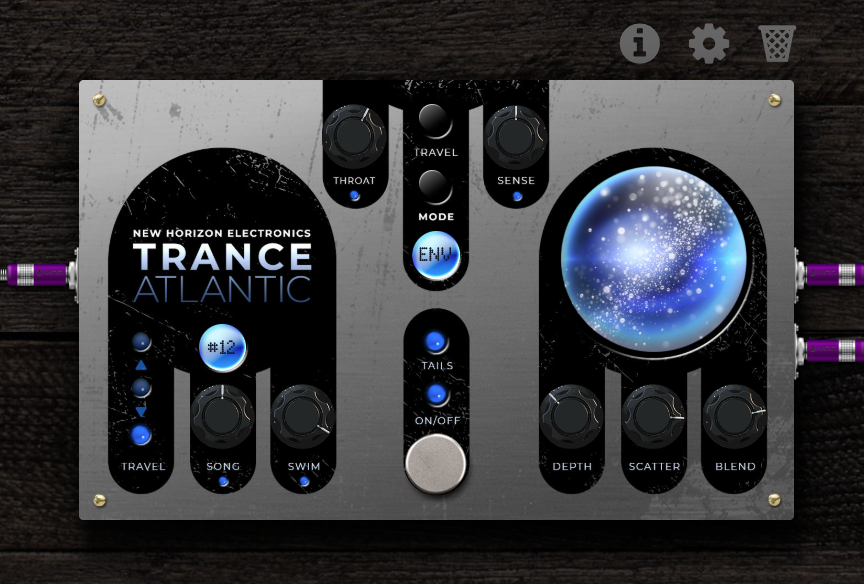

# Trance Atlantic

**Swim in international waters**

Take your sound below the waves and travel to the unexplored! Inspired by the gentle giants of the deep, the New Horizon Electronics Trance Atlantic is a rare beast: half envelope-controlled pitch shifter, half underwater reverb simulator. For MOD Duo, Duo X and Dwarf.



## Built for sonic exploration

A vast array of tones: haunting pitch bends, literal whale calls, or just the subtle density of hearing your instrument cross a vast distance along the seafloor.

## Why it sounds like nothing else

A normal reverb models a room. The ocean has no walls, so Trance Atlantic models the water instead:

- **Sound arrives in bounces, not reflections.** The direct arrival comes first, then the surface and seabed bounces, each one flipped, darker and further away. No cave, no hall.
- **Lows arrive late.** In shallow water each frequency travels at its own speed, so a pluck reaches you as a falling chirp. Scatter sets how far it smears.
- **The surface moves.** A flipped reflection from the surface drifts with the swell, so the tail swirls the way sound does under rolling water.
- **It comes from everywhere.** Underwater, your ears can't tell where a sound is. The image stays narrow and close, not wide and roomy.
- **Pitch from motion, not a pitch shifter.** The bend comes from a moving delay, like the Doppler shift of a passing whale. It's smooth and glitch-free. Swoops up start late and catch up; dives start straight away.
- **Your hands drive it.** How hard you play opens the throat, sizes the swoop and blooms the call. Switch the envelope off and it becomes a pure underwater reverb.
- **Deep, dark and clean.** A steep 24 dB/octave darkness, and the lows drain out of the wash, so long tails hang without booming.

## At the helm

| Control | What it does |
| --- | --- |
| **Sense** | How hard you have to play to drive the envelope: swoop size, bloom and throat. Raise it for a soft touch, lower it for hot pickups or synths |
| **Song** | How far a full pluck swoops, 0 to 24 semitones. The readout shows it (#05 = 5 semitones) |
| **Swim** | How fast the call moves, 100 ms to 2 s: the swoop, the bloom (the call fades in at this speed) and the throat opening |
| **Travel** | The shape of the swoop. **Up**: rises on the attack and settles. **Arc**: up on the attack, down as the note fades. **Down**: dives on the attack, no lag. Press the button to step, or tap a light to pick |
| **Throat** | Where the throat sings. 12 o'clock is the home sound. Turn left and it slides down and widens (bass). Turn right and it slides up and narrows (more vocal) |
| **Mode** | **ENV**: the throat follows your playing, Mu-Tron style. **FIX**: the throat holds still at the Throat setting. **OFF**: no envelope anywhere (no throat, no swoop, no bloom), just the ocean |
| **Depth** | How far away the call is: pre-delay up to 120 ms, wider bounces, a longer wash (about 2 to 6 s) and a darker sea |
| **Scatter** | How much the deep smears a note: from none to a long falling "pew" (the lows land about 37 ms behind the highs at full) |
| **Blend** | Your dry signal against the call. At 50% both are at full level; at 100% only the call |
| **Tails** | Bypass lets the ocean ring out |
| **On/Off** | Bypass, click-free; the dry signal passes at unity |

The status lights show which controls are live. In **OFF**, Throat, Sense, Song, Swim and Travel go dark, and the Song readout dims.

**The orb** is a live picture of the settings: Depth, Scatter and Blend each fade in a layer, and the ripples on top follow your input level as you play.

Mono in, stereo out. The image is narrow on purpose, so it collapses to mono well.

## Factory presets

| Preset | Sound |
| --- | --- |
| **Trance Atlantic** | The default: a far, scattered call with plenty of ocean |
| **Choral Reef** | Close and clear: more of you, a light call |
| **Deep sea detune** | A slow dive with the throat up high and the sea washing over it |
| **A Million Miles** | An octave dive on every note, slow and far, with the throat down low |
| **Whale Call** | The classic: an octave dive into a deep, scattered sea |
| **Just drifting aimlessly** | No envelope, all ocean: the call only, at full depth, crystal clear |
| **Converging streams** | Close and dry-led: a gentle two-semitone sag that never quite leaves you |
| **Bouncing of the Floor** | The same sag, sent to the deepest, most scattered water |

## Install

**Test builds:** upload `mod-plugin-builder/nhe-trance-atlantic/nhe-trance-atlantic.mk` to <https://builder.mod.audio/buildroot> with your MOD connected over USB, then click Install. Set `NHE_TRANCE_ATLANTIC_VERSION` in that file to the full hash of the commit you want to build.

**MOD Plugin Store:** not yet.

## Build from source

```sh
git clone --recursive https://github.com/Kiwooky/NHE-Trance-Atlantic
make                 # builds bin/nhe-trance-atlantic.lv2
make install DESTDIR=/path PREFIX=/usr
```

DPF (DISTRHO Plugin Framework) is a git submodule in `dpf/`, pinned at commit `61d38eb638449647fb8395a35c5b8dab7e981ba7`. Cross-compile by setting `CC`, `CXX` and `CXXFLAGS` as usual.

Testing, measurements and known issues: [DEVELOPER-NOTES.md](DEVELOPER-NOTES.md). The design: [docs/spec.md](docs/spec.md).

## Repository layout

| Path | Contents |
| --- | --- |
| `plugins/nhe-trance-atlantic/` | DSP source (C++, DPF) |
| `bundle/nhe-trance-atlantic.lv2/` | LV2 metadata, factory presets, pedal face (template, CSS, script, images) |
| `mod-plugin-builder/` | Package file for MOD's builder and plugin store |
| `tests/` | Audio test suite |
| `tools/` | Test gate, offline LV2 host, CPU benchmark, face tests (from the MOD plugin playbook) |
| `docs/` | Design spec |
| `dpf/` | DISTRHO Plugin Framework, git submodule (ISC) |

## Licence

Code: GPL-3.0-or-later ([LICENSE](LICENSE)). Artwork: © New Horizon Electronics ([ARTWORK-LICENSE.md](ARTWORK-LICENSE.md)). DPF: ISC ([dpf/LICENSE](dpf/LICENSE)). The readouts are pre-rendered from the free DotMatrix font (dafont.com).

The reverb's tank and diffuser lengths come from Jon Dattorro's "Effect Design, Part 1" (J. Audio Eng. Soc., 1997), as in NHE Taj Mahal.
